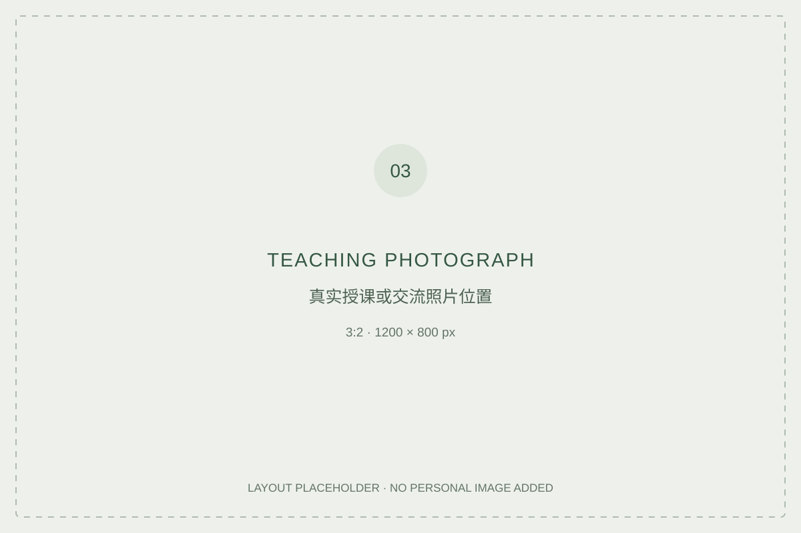

# Expertise & teaching

**Industry experience, institutional recognition & professional knowledge**

> Status: research framework. The institution, formal appointment title and teaching record remain to be documented.

## Research question

How does industry experience become recognised as expertise when practitioners take on university teaching roles?

## Context

**TEXT 05 — 80–120 words.** State the university, appointment title exactly as recorded, appointment dates, actual teaching or mentoring responsibilities and relevant materials. Include a photograph caption identifying the event, date and the applicant's role.

## Analytical focus

- The relationship between practical experience and institutional recognition.
- Which professional experiences can be taught, and how they are selected and explained.
- The perspective and limits that come with a practitioner position.

## Article

**TEXT 06 — 1,800–1,900 words once authored.**

Suggested sections: question; documented context; relevant literature; analysis of expertise and recognition; practitioner reflexivity; conclusion; references.

A personal recollection must be identified as a recollection. An appointment letter documents an appointment; it does not by itself establish teaching outcomes.

## Supporting material

[Appointment and professional records](https://github.com/xuliangweiming/professional-background)

Add links to the exact records and public institutional materials once available. No observations, student comments or interview material have been supplied.

## Image guidance

IMAGE 03 is for one genuine teaching or professional exchange photograph. Place the appointment-letter scan in the background repository, with a readable title and explanatory caption.

---

[Back to profile](https://github.com/xuliangweiming)
